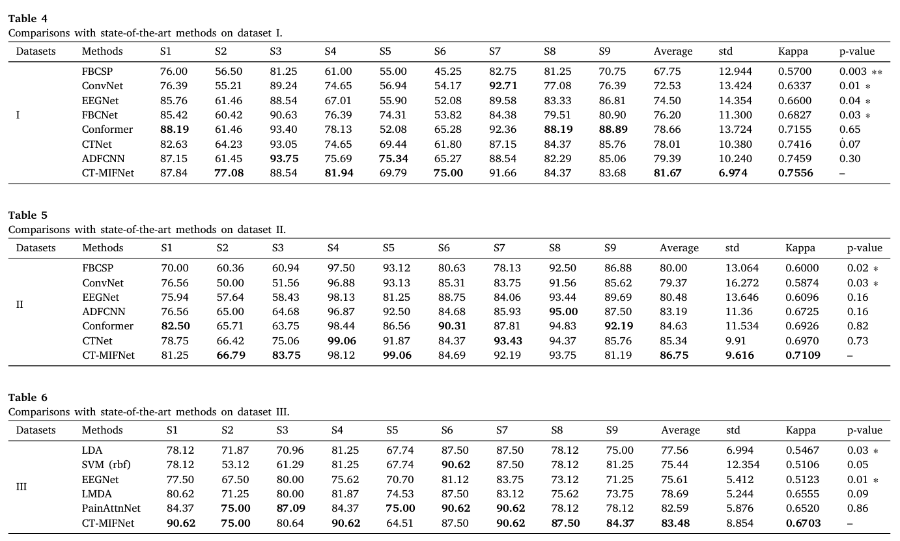

<h1 align="center">CT-MIFNet</h1>

<p align="center"><strong>Convolutional Transformer-based Multi-View Interaction and Fusion Network for EEG Decoding</strong></p>

<p align="center">
  <a href="https://doi.org/10.1016/j.bspc.2025.108421"></a>
  <a href="https://openneuro.org/datasets/ds005285/versions/1.0.0"></a>
  <a href="LICENSE"></a>
</p>

<p align="center">
  <a href="#architecture">Architecture</a> &nbsp;·&nbsp;
  <a href="#datasets-and-results">Results</a> &nbsp;·&nbsp;
  <a href="#run-an-experiment">Training</a> &nbsp;·&nbsp;
  <a href="#citation">Citation</a>
</p>

## Architecture

CT-MIFNet decodes motor imagery and laser-evoked pain from EEG. One branch follows the signal over time. The other uses a fast Fourier transform (FFT) to represent the same trial in the frequency domain. Multi-scale convolutions extract features from each view, and **cross-covariance attention** lets the two branches exchange information before classification.

[](Figure_01.png?raw=true)

<p align="center"><sub><a href="Figure_01.png?raw=true">View the architecture diagram at full resolution</a></sub></p>

## Datasets and results

Accuracy and Cohen’s κ are averaged across nine subjects per dataset. [Paper, Tables 4–6](https://doi.org/10.1016/j.bspc.2025.108421).

| Dataset | EEG task | Accuracy | κ |
| --- | --- | ---: | ---: |
| [BCI IV-2a](https://www.bbci.de/competition/iv/desc_2a.pdf) | 4-class motor imagery | **81.67%** | 0.7556 |
| [BCI IV-2b](https://www.bbci.de/competition/iv/desc_2b.pdf) | 2-class motor imagery | **86.75%** | 0.7109 |
| [EDLEP](https://openneuro.org/datasets/ds005285/versions/1.0.0) | 2-class pain perception | **83.48%** | 0.6703 |

For EDLEP, we used subjects 1, 3, 5, 8, 10, 12, 15, 18 and 28 from OpenNeuro release 1.0.0.

<details>
<summary>Compare methods and individual subjects (Tables 4–6)</summary>

[](Figure_04.png?raw=true)

</details>

## Run an experiment

Install a CUDA-enabled build of PyTorch for your GPU, then install the shared Python dependencies. [PyTorch installation guide](https://pytorch.org/get-started/locally/).

```bash
python -m pip install numpy scipy scikit-learn einops matplotlib seaborn
```

Set `gpus` in the training script to the CUDA devices you will use. Pass the prepared data directory with `--data-dir`. Use `--subjects` to select one or more participants in the order you want to run them.

<details>
<summary><strong>Prepare BCI Competition IV data</strong></summary>

Use MATLAB with BioSig and the Signal Processing Toolbox to preprocess each subject’s GDF recordings and class labels. Set the input and output paths in the MATLAB function for your dataset, then call it with the subject number (1–9). [Competition recordings](https://bbci.de/competition/iv/download/) · [Class labels](https://www.bbci.de/competition/iv/results/index.html).

- **2a.** Running [`BCI_2a_getData(3)`](processing/BCI_2a_getData.m) writes `A03T.mat` and `A03E.mat`. The training script saves a checkpoint for each subject and places its two heatmaps in a matching `subject-XX` subdirectory.
- **2b.** Running [`BCI_2b_getData(9)`](processing/BCI_2b_getData.m) writes `B09processing_T.mat` and `B09processing_E.mat`. The loader uses this pair when available and accepts a complete pair with the older `A` prefix.

Without `--subjects`, both BCI scripts train subjects 1 through 9.

</details>

<details>
<summary><strong>Prepare EDLEP data</strong></summary>

Install MNE-Python (`python -m pip install mne`). The loader reads epoched EEGLAB files such as `sub-001_29ByANT.set` from `--data-dir`. Keep the matching `.fdt` alongside each `.set` file. By default, the script trains the nine EDLEP subjects listed in [Datasets and results](#datasets-and-results).

The released script applies common spatial patterns (CSP) in `get_event_data()`. In our pain-perception experiments, CSP reduced performance. We recommend omitting this spatial filter when adapting CT-MIFNet beyond motor imagery.

</details>

Run the command for your dataset from the repository root. This example trains BCI IV-2b subjects 2 and 7.

```bash
python CT_MIFNet_2b.py --data-dir ./data/2b --subjects 2 7
```

On BCI IV-2a, `--output-dir` sets the directory for checkpoints and heatmaps. On EDLEP, it sets the directory for the results log.

| Dataset configuration | Training command |
| --- | --- |
| [BCI IV-2a](config.py) | [`python CT_MIFNet.py`](CT_MIFNet.py) |
| [BCI IV-2b](config_2b.py) | [`python CT_MIFNet_2b.py`](CT_MIFNet_2b.py) |
| [EDLEP](config_newdata.py) | [`python CT_MIFNet_newdata.py`](CT_MIFNet_newdata.py) |

<details>
<summary>Implementation guide</summary>

- Each training script defines the network, the `Trans` training and evaluation class, and the subject loop in `main()`. The EDLEP script names its model class `TFCformer`.
- The spatial filters are implemented separately for [BCI IV-2a](commom_spatial_pattern.py), [BCI IV-2b](commom_spatial_pattern_2b.py) and [EDLEP](commom_spatial_pattern_newdata.py).
- The FFT and label-smoothing helpers are in [metric.py](metric.py) for BCI and [metric_newdata.py](metric_newdata.py) for EDLEP.

</details>

## Citation

If you use CT-MIFNet, please cite our model paper. If you use EDLEP, please also cite the dataset paper.

<details>
<summary><strong>CT-MIFNet</strong> · Xiong et al., <em>Biomedical Signal Processing and Control</em> (2026)</summary>

```bibtex
@article{XIONG2026108421,
  title   = {{CT-MIFNet}: Convolutional transformer-based multi-view interaction and fusion network for {EEG} decoding},
  author  = {Yibo Xiong and Jinming Li and Yun Zhuang and Xiangyue Zhao and Yilu Xu and Lilin Jie},
  journal = {Biomedical Signal Processing and Control},
  volume  = {112},
  pages   = {108421},
  year    = {2026},
  doi     = {10.1016/j.bspc.2025.108421}
}
```

</details>

<details>
<summary><strong>EDLEP dataset</strong> · Zhao et al., <em>Scientific Data</em> (2025)</summary>

[Read the dataset paper](https://doi.org/10.1038/s41597-025-05900-1).

```bibtex
@article{zhao2025comprehensive,
  title   = {A comprehensive {EEG} dataset of laser-evoked potentials for pain research},
  author  = {Xiangyue Zhao and Jingyao Zhou and Libo Zhang and Yun Zhuang and Haoqing Duan and Shiyu Wei and Suchen Yao and Xuejing Lu and Yanzhi Bi and Li Hu},
  journal = {Scientific Data},
  volume  = {12},
  number  = {1},
  pages   = {1536},
  year    = {2025},
  doi     = {10.1038/s41597-025-05900-1}
}
```

</details>

## Acknowledgements

We thank the authors of [EEG-Transformer](https://github.com/eeyhsong/EEG-Transformer) and [TFF-Former](https://github.com/lixujin1999/TFF-Former) for the code this implementation builds on.

For questions about the implementation, open a [GitHub issue](https://github.com/XCZchaos/CT-MIFNet/issues) or email [asherxiong552@gmail.com](mailto:asherxiong552@gmail.com).
